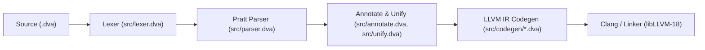

---
meta:
  audience: "compiler contributors"
  status: "current reference"
  audited: "7f68d72"
  evidence: "`Makefile`, `test_driver.sh`, `operators.yaml`, `tools/opgen/main.nu`, `tools/check_docs.nu`, `src/edva.dva`, `src/pkg.dva`, `src/codegen/types.dva`, `src/codegen/stmt.dva`, `src/codegen/expr.dva`"
---

# Compiler Architecture, Bootstrap & Testing

The Edva compiler (`./edva`) is completely self-hosted in Edva (`src/*.dva`) and emits LLVM 18 textual IR (`.ll`) compiled and linked by `clang`.

## Compiler pipeline and source map

| Stage / Subsystem | Primary Source Files | Responsibilities |
|---|---|---|
| **CLI & Driver** | `src/edva.dva`, `src/pkg.dva` | CLI flag/subcommand parsing, module graph loading, IR caching (`~/.cache/edva/ir/`), package manager subcommands, and `clang` invocation |
| **Operator Table (SSOT)** | `operators.yaml`, `tools/opgen/main.nu`, `src/operators.dva` | Single source of truth for operator tiers, LBP/RBP binding powers, associativity, and generated tables |
| **Lexical Analysis** | `src/lexer.dva`, `src/token.dva` | UTF-8 scanning, indentation stack (`INDENT`/`DEDENT`), string margin stripping, `${...}` interpolation tokens |
| **Parsing** | `src/parser.dva`, `src/ast.dva` | Pratt expression parsing, choice guard classification, headless choice/section synthesis, `#type` / `#` meta-language AST nodes |
| **Annotation & Unification** | `src/annotate.dva`, `src/unify.dva`, `src/layout.dva` | Scope resolution, primed mutability, definite field initialization (`E3130`), Hindley-Milner type unification, `#const` / `#param` CTFE |
| **LLVM IR Codegen** | `src/codegen/main.dva`, `src/codegen/types.dva`, `src/codegen/expr.dva`, `src/codegen/stmt.dva`, `src/codegen/match.dva`, `src/codegen/runtime.dva` | Lowering to typed LLVM 18 IR: whole-TU function effect summaries (`FnEffectSummary`), unboxed `{ i1, i64 }` rams, null-niche pointers, arena generation checks (`E4010`/`E4011`), SIMD intrinsics |
| **Standard Library** | `std/*.dva` | 43 standard library modules resolved via `#use <module>` |

## Whole-TU function effect summaries, escape/retention analysis & arena lifetime checking

Before lowering functions to LLVM IR, `stmt::run_typed_fn_summaries` (`src/codegen/stmt.dva`) indexes all function bodies in $O(1)$ (`types::fneff.entries` / `types::fneff.idx`, eliminating repeated linear scans over `typed_program_stmts`) and runs a monotone least-fixed-point solver over all functions with bodies in the compilation unit, populating `types::fneff.summaries` (`FnEffectSummary` in `src/codegen/types.dva`). Newly specialized generic functions (`compile_typed_mono_fn`) incrementally register and solve their summaries via `stmt::register_mono_fn_summary`:

| Summary Field | Meaning & Consumer |
|---|---|
| `may_arena_effect` | `<+>` if the function or any transitive callee may restore (`mem::restore_to`), reset (`mem::reset`), destroy/release (`mem::destroy`, `mem::release`), switch (`mem::set_current`, `mem::with`, `mem::escape`), or adopt an arena |
| `may_read_global` / `may_write_global` | `<+>` if the function or any transitive callee may read or mutate a module/marked global variable (`expr::fn_writes_outer` consults `may_write_global` in $O(1)$) |
| `param_str_read_only_mask` | Bitmask of parameters (bits `0..61`) whose `String` value is only read locally or passed to read-only parameter slots (`can_stack_str`, `fast_freeze_builders`, temporary `String` call args) |
| `param_rec_proj_only_mask` | Bitmask of parameters (bits `0..61`) whose record or `<Rec|>` niche-ram value is only field-projected locally without escaping (`can_stack_rec`, temporary record/`<Rec|>` call args) |
| `param_str_header_mask` | String parameters whose descriptors stay local even when a callee reads or borrows their byte addresses. Used for stack promotion of temporary descriptors. |
| `param_mutated_mask` | Bitmask of parameters mutated in-place (`.field =`, index write, `+=`, `@[p] =`, or `&param` address-of) |
| `param_invoked_mask` | Bitmask of callable parameters invoked directly or transitively (including via non-escaping local composition closures such as `fg = f .> g`); at call sites, `callee_call_may_arena_effect` combines `cs.may_arena_effect` with the arena effects of any argument passed to an invoked parameter slot |
| `param_escapes_mask` | Bitmask of parameters returned, stored into outer/global state, or captured by an escaping closure (`param_ret_alias_mask .|. param_retained_mask`, plus any non-projection/non-read-only value escape) |
| `param_ret_alias_mask` | Bitmask of parameters that may alias the function's return value (returned in tail position or via `Return`, wrapped in a returned record/ram/enum/map literal, or forwarded through a tail call whose callee has `param_ret_alias_mask` set) |
| `param_retained_mask` | Bitmask of parameters that may be retained after the call returns (stored into a global or outer variable, written into another parameter via member/index/raw write or `+=`, captured by an escaping closure, or passed to an unknown/foreign sink) |

### Soundness, stack promotion, separate compilation (`-c --module`), and cache invalidation

- **Fixed-point convergence on recursive SCCs:** Functions with bodies in the TU start at the bottom of the effect lattice (`may_arena_effect = <->` unless the function is itself a primitive arena restore op, `param_str_read_only_mask = all_1s`, `param_rec_proj_only_mask = all_1s`, `param_mutated_mask = 0`, `param_invoked_mask = 0`, `param_escapes_mask = 0`, `param_ret_alias_mask = 0`, `param_retained_mask = 0`) and iterate monotonically to a fixed point (`<= 8` passes), so mutually recursive pure helpers remain eligible for stack allocation and check elimination while any arena restore, return alias, or retention in a cycle propagates across the entire SCC.
- **Generalized stack promotion (`Record`, `<Rec|>`, `String`, `Builder`, and closures):** Using the memoized `FnEffectSummary` table, `stmt::codegen_typed_eval_assign` and `expr::eval_call_arg_sync_clo` stack-promote:
  - Non-escaping local records and `<Rec|>` niche-ram choices (`%rec.salloc`) regardless of the enclosing function's return type whenever `rec_var_safe_expr` proves the variable does not escape or alias the return value.
  - Non-escaping local closures (`closure_var_non_escaping`) and inline lambda call arguments (`%clo.salloc`, `%env.salloc`) passed to any user-defined or specialized generic function whose summary proves `!may_arena_effect && !escapes && !retained && !ret_alias` (generalizing beyond hardcoded stdlib allowlists).
  - Temporary `Record`, `<Rec|>`, and `String` call arguments passed directly to parameter slots with `param_rec_proj_only_mask` or `param_str_read_only_mask` set.
- **Conservative boundary for unknown, foreign, and interface-only callees:** In modular separate compilation (`-c --module`), imported `#use` dependencies are loaded as interface signatures (`interface_only = <+>`). Any call to a function without a body in the TU, an unannotated `#foreign("c")` symbol, or an indirect closure variable not resolved to a known summary defaults conservatively to `may_arena_effect = <+>` and parameter escape unless covered by the compiler's explicit pure stdlib/intrinsic contracts (`callee_is_known_arena_effect_free`, `is_known_safe_str_callee`).
- **Lifetime-check elimination (`E4010` / `E4011`) and generation tagging:** When a function has `types::g.current_fn_has_restore == <+>` (or executes inside a block/loop restore scope `cg.in_restore_scope > 0`), newly constructed `String` headers and `&b` / `&s` `Addr` pointers are stamped with the active 16-bit arena generation (`dva_active_gen_tls` in bits `48..63`), and every `String` length read or `Addr` dereference validates the tag against the active scope stack (`E4010: stale String read after arena restore`, `E4011: stale Addr dereference after arena restore`), including inside `@` cycles. When `current_fn_has_restore == <->` and `in_restore_scope == 0`, generation checks and heap allocations for non-escaping temporaries are safely elided.
- **Internal String descriptors at `-O2`:** LLVM argument promotion can pass the tagged length and data pointer in separate arguments when an internal callee only reads the descriptor and LLVM can rewrite every caller. A nonpacked heap record constructor in an internal function can store an exclusively owned slice descriptor at the end of the record allocation. The field still holds a pointer to the descriptor, so record offsets and externally visible C, module, and Wasm signatures retain their existing ABI. Only the header moves. The slice points to the original bytes. The compiler keeps separate allocations for shared descriptors, constructors in loops or functions that may switch or restore arenas, and arenas whose chunks are too small for the combined allocation.
- **Reachability before IR output:** The compiler verifies the lowered module, removes stores to internal globals with no readers or escaping addresses, and runs LLVM's global reachability pass before serializing IR. Externally linked definitions, module constructors, and references through live closures remain roots or reachable dependencies. Standalone builds also let the pass discard unused arena implementation helpers. Generic instances are indexed per template using resolved type and layout information and exact compile-time values.

- **Cross-module, object & artifact cache invalidation (`--timings`, `key_version = 4`):** `pkg::compute_ir_cache_key` (`src/pkg.dva`) hashes the compiler identity (executable fingerprint), backend toolchain identity (`pkg::backend_toolchain_id`, probing `clang --version` and `wasm-ld --version`), compilation mode (`full`, `module:<name>`, `entry`, `fuzz_cov`), target triple, optimization level, `--cflag` list (including content hashes of file-backed native link inputs such as `.o`, `.a`, `.so`, `.dylib`), and the path + content hash of every transitively loaded `.dva` file in deterministic dependency order. Alongside cached LLVM IR (`entries/<key>/output.ll`), `pkg::cache_store_artifact` / `pkg::cache_lookup_artifact` atomically cache and restore compiled objects (`output.o`) and linked artifacts (`output.bin`, `output.so`, `output.wasm`) with 0-byte corruption recovery, avoiding `clang` and linker invocation on warm cache hits. Passing `--timings` emits machine-readable JSON phase timings (`load_parse`, `type_specialize`, `analysis`, `ir_emit`, `backend_opt`, `link`, `total`, `ir_cache_hit`, `artifact_cache_hit`).

## Self-hosting bootstrap and fixed-point verification

When `./edva` is not yet built on a clean checkout, `make` links the checked-in bootstrap seed IR (`seed/ir/*.ll`) with `clang` to produce the initial compiler binary.

| Command | Stage Flow | Verification Guarantee |
|---|---|---|
| `make edva` | Existing `./edva` (or `seed/ir/` bootstrap) $\to$ `./edva` | Incremental module compilation using `.build/` cache |
| `make fixed-point` | `./edva` $\to$ `edva_stage1` ($\text{IR}_1$) $\to$ `edva_stage2` ($\text{IR}_2$) | Asserts $\text{IR}_1 \equiv \text{IR}_2$ byte-for-byte across all compiler modules before promoting `edva_stage1` to `./edva` |
| `make update-seed` | Copies verified Stage 2 `.ll` files into `seed/ir/` | Run only when intentionally updating the bootstrap seed after an ABI/feature transition |
| `make check` | `make build` $\to$ `make driver-test` $\to$ `make test` | Full end-to-end build and test gate |

## Test suites and verification harnesses

| Suite / Tool | Invocation | Scope & Pass Criteria |
|---|---|---|
| **Full test driver** | `./test_driver.sh` | Runs all pass, fail, CLI, package, and documentation checks |
| **Filtered test run** | `./test_driver.sh <substring>` | Runs only test cases matching `<substring>` (e.g. `./test_driver.sh 393`) |
| **Positive tests** | `tests/pass/*.dva` | Must compile and exit `0`, matching expected stdout/output assertions |
| **Negative diagnostics** | `tests/fail/*.dva` | Must fail compilation or runtime execution with the exact `// expected-error: EXXXX` code |
| **Package manager tests** | `tests/pkg/` | Exercises `edva init`, `add`, `fetch`, `build`, `test`, `vendor`, `--locked`, `--offline` |
| **Operator sync check** | `nu tools/opgen/main.nu --check` | Verifies `src/operators.dva`, `GRAMMAR.md`, `doc/llms.txt`, `doc/llms-full.txt`, and `doc/reference/language/operators.qmd` match `operators.yaml` |
| **Docs & snippet check** | `nu tools/check_docs.nu --compile-examples` | Validates YAML frontmatter (`meta.*`), verifies `meta.evidence` paths exist, and compiles/runs `.dva` code blocks in `doc/**/*.qmd` |
| **Quarto book build** | `cd doc && quarto render` | Renders the HTML documentation book into `doc/_build/` |

## Documentation authoring rules (`doc/**/*.qmd`)

Every `.qmd` chapter in `doc/` is validated by `nu tools/check_docs.nu`:

| Requirement | Specification |
|---|---|
| **YAML frontmatter** | Every `.qmd` file must define `meta.audience`, `meta.status`, `meta.audited` (git commit hash), and `meta.evidence` (backtick-quoted repo paths verified to exist) |
| **`{.dva .run}`** | Self-contained snippet compiled and executed (`./edva -r`) by `check_docs.nu --compile-examples` |
| **`{.dva .complete}`** | Self-contained module compiled (`--ir`) without executing (used for blocking I/O, servers, or OS-specific calls) |
| **`{.dva .partial}`** | Illustrative fragment referencing surrounding context; skipped during standalone snippet compilation |
| **`{.dva expected-error="EXXXX"}`** | Snippet that must fail compilation with diagnostic `EXXXX` |
