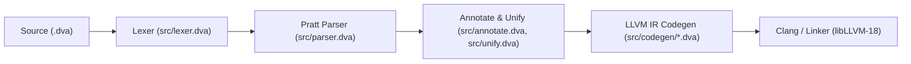

---
meta:
  audience: "compiler contributors"
  status: "current reference"
  audited: "8b8cb19"
  evidence: "`Makefile`, `test_driver.sh`, `operators.yaml`, `tools/opgen/main.nu`, `tools/check_docs.nu`, `src/edva.dva`"
---

# Compiler Architecture, Bootstrap & Testing

The Edva compiler (`./edva`) is completely self-hosted in Edva (`src/*.dva`) and emits LLVM 18 textual IR (`.ll`) compiled and linked by `clang`.

## Compiler pipeline and source map

| Stage / Subsystem | Primary Source Files | Responsibilities |
|---|---|---|
| **CLI & Driver** | `src/edva.dva`, `src/pkg.dva` | CLI flag/subcommand parsing, module graph loading, IR caching (`~/.cache/edva/ir/`), package manager subcommands, and `clang` invocation |
| **Operator Table (SSOT)** | `operators.yaml`, `tools/opgen/main.nu`, `src/operators.dva` | Single source of truth for operator tiers, LBP/RBP binding powers, associativity, and generated tables |
| **Lexical Analysis** | `src/lexer.dva`, `src/token.dva` | UTF-8 scanning, indentation stack (`INDENT`/`DEDENT`), string margin stripping, `${...}` interpolation tokens |
| **Parsing** | `src/parser.dva`, `src/ast.dva` | Pratt expression parsing, choice guard classification, headless choice/section synthesis, `#type` / `#!` AST nodes |
| **Annotation & Unification** | `src/annotate.dva`, `src/unify.dva`, `src/layout.dva` | Scope resolution, primed mutability, definite field initialization (`E3130`), Hindley-Milner type unification, `#!` CTFE |
| **LLVM IR Codegen** | `src/codegen/main.dva`, `src/codegen/types.dva`, `src/codegen/expr.dva`, `src/codegen/stmt.dva`, `src/codegen/match.dva`, `src/codegen/runtime.dva` | Lowering to typed LLVM 18 IR: unboxed `{ i1, i64 }` rams, null-niche pointers, arena generation checks (`E4010`), SIMD intrinsics |
| **Standard Library** | `std/*.dva` | 43 standard library modules resolved via `#use <module>` |

## Self-hosting bootstrap and fixed-point verification

When `./edva` is not yet built on a clean checkout, `make` links the checked-in bootstrap seed IR (`seed/ir/*.ll`) with `clang` to produce the initial compiler binary.

| Command | Stage Flow | Verification Guarantee |
|---|---|---|
| `make edva` | Existing `./edva` (or `seed/ir/` bootstrap) $\to$ `./edva` | Incremental module compilation using `.build/` cache |
| `make fixed-point` | `./edva` $\to$ `edva_stage1` ($\text{IR}_1$) $\to$ `edva_stage2` ($\text{IR}_2$) | Asserts $\text{IR}_1 \equiv \text{IR}_2$ byte-for-byte across all compiler modules before promoting `edva_stage1` to `./edva` |
| `make update-seed` | Copies verified Stage 2 `.ll` files into `seed/ir/` | Run only when intentionally updating the bootstrap seed after an ABI/feature transition |
| `make check` | `make build` $\to$ `make driver-test` $\to$ `make test` | Full end-to-end build and test gate |

## Test suites and verification harnesses

| Suite / Tool | Invocation | Scope & Pass Criteria |
|---|---|---|
| **Full test driver** | `./test_driver.sh` | Runs all pass, fail, CLI, package, and documentation checks |
| **Filtered test run** | `./test_driver.sh <substring>` | Runs only test cases matching `<substring>` (e.g. `./test_driver.sh 393`) |
| **Positive tests** | `tests/pass/*.dva` | Must compile and exit `0`, matching expected stdout/output assertions |
| **Negative diagnostics** | `tests/fail/*.dva` | Must fail compilation or runtime execution with the exact `// expected-error: EXXXX` code |
| **Package manager tests** | `tests/pkg/` | Exercises `edva init`, `add`, `fetch`, `build`, `test`, `vendor`, `--locked`, `--offline` |
| **Operator sync check** | `nu tools/opgen/main.nu --check` | Verifies `src/operators.dva`, `GRAMMAR.md`, `doc/llms.txt`, `doc/llms-full.txt`, and `doc/reference/language/operators.qmd` match `operators.yaml` |
| **Docs & snippet check** | `nu tools/check_docs.nu --compile-examples` | Validates YAML frontmatter (`meta.*`), verifies `meta.evidence` paths exist, and compiles/runs `.dva` code blocks in `doc/**/*.qmd` |
| **Quarto book build** | `cd doc && quarto render` | Renders the HTML documentation book into `doc/_build/` |

## Documentation authoring rules (`doc/**/*.qmd`)

Every `.qmd` chapter in `doc/` is validated by `nu tools/check_docs.nu`:

| Requirement | Specification |
|---|---|
| **YAML frontmatter** | Every `.qmd` file must define `meta.audience`, `meta.status`, `meta.audited` (git commit hash), and `meta.evidence` (backtick-quoted repo paths verified to exist) |
| **`{.dva .run}`** | Self-contained snippet compiled and executed (`./edva -r`) by `check_docs.nu --compile-examples` |
| **`{.dva .complete}`** | Self-contained module compiled (`--ir`) without executing (used for blocking I/O, servers, or OS-specific calls) |
| **`{.dva .partial}`** | Illustrative fragment referencing surrounding context; skipped during standalone snippet compilation |
| **`{.dva expected-error="EXXXX"}`** | Snippet that must fail compilation with diagnostic `EXXXX` |
